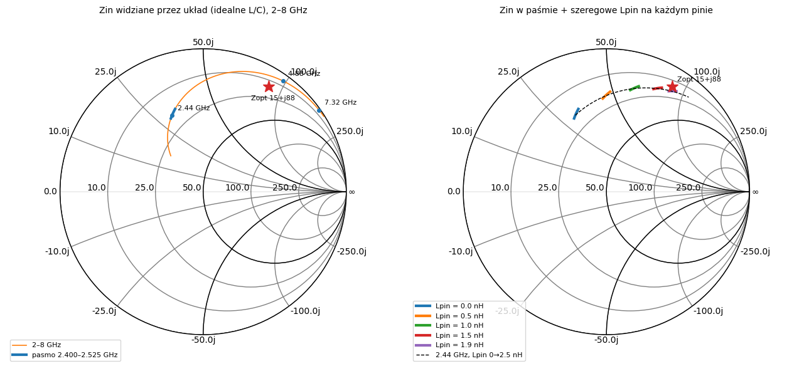
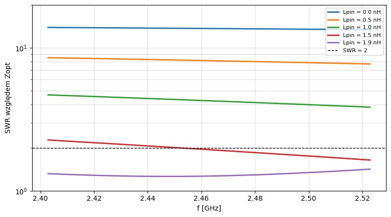
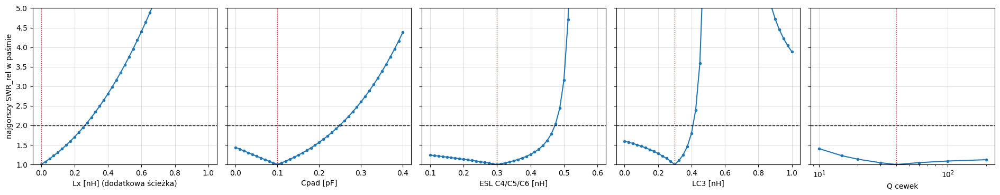
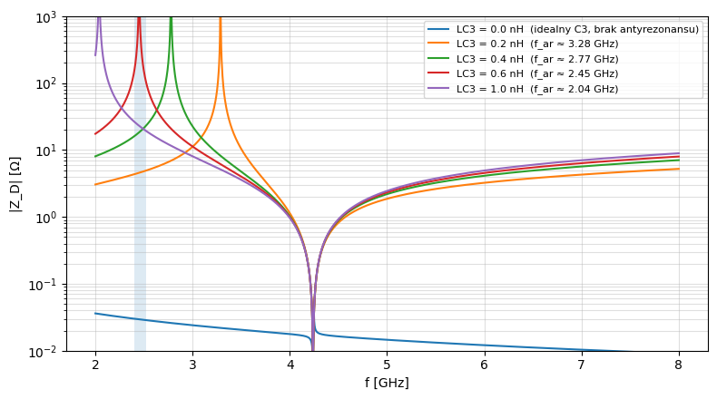
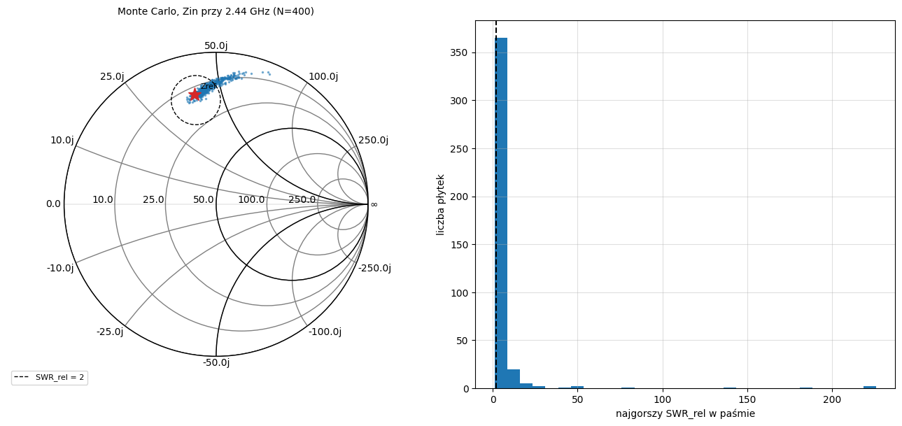

# Symulacja sieci dopasowującej nRF24L01+ (etap schematu)

**Etap:** schemat, przed layoutem
**Narzędzia:** Python, scikit-rf (`antenna__matching.ipynb`)
**Źródła:** nota nRF24L01+ (rozdz. 11 „Application example”), TI SWRU120D „2.4-GHz Inverted F Antenna”

## 1. Cel

Zanim powstanie layout, chciałem odpowiedzieć na trzy pytania:

1. Co dokładnie robi sieć dopasowująca z noty i czy wartości z BOM-u dają obciążenie zalecane przez producenta.
2. Jak sieć filtruje harmoniczne (4,88 i 7,32 GHz).
3. Na jakie pasożyty i tolerancje sieć jest wrażliwa. Z tego wynikają reguły dla layoutu.

## 2. Model

### Topologia (z rysunku noty)

| Węzeł | Gdzie |
|---|---|
| A | ANT2 (pin 13) |
| B | ANT1 (pin 12) |
| D | VDD_PA (pin 11) |
| M | punkt między L3 i C5 |
| OUT | wyjście 50 Ω do anteny |

| Element | Wartość | Połączenie |
|---|---|---|
| L1 | 8,2 nH | A – B |
| L2 | 2,7 nH | B – D |
| L3 | 3,9 nH | A – M |
| C5 | 1,5 pF | M – OUT |
| C6 | 1,0 pF | OUT – GND |
| C3 | 2,2 nF | D – GND |
| C4 | 4,7 pF | D – GND |

Sieć to **balun na elementach skupionych**. Sygnał do anteny idzie tylko z ANT2. ANT1 jest sprowadzony do masy w.cz. przez L2 i węzeł D, a L1 i L2 doprowadzają jednocześnie napięcie DC z VDD_PA do obu wyjść wzmacniacza.

### Port różnicowy

Wyjście nRF jest różnicowe (ANT1–ANT2), a porty w scikit-rf mają odniesienie do masy. Dlatego model ma trzy porty jednostronne: ANT2, ANT1 i OUT. Port OUT jest obciążony 50 Ω. Impedancję widzianą przez układ liczę z macierzy Z:

$$Z_d = Z_{11} + Z_{22} - Z_{12} - Z_{21}$$

Wynik sprawdziłem ręcznym rachunkiem węzłowym dla 2,44 GHz: L1 ∥ (Z_A + Z_B). Oba sposoby dają tę samą wartość.

### Kryteria

- Obciążenie zalecane przez Nordic: **Zopt = 15 + j88 Ω** (nota: „simulated values”).
- Odległość od celu mierzę współczynnikiem odbicia mocy i SWR:

$$\Gamma = \frac{Z_{in}-Z_{opt}}{Z_{in}+Z_{opt}^*}, \qquad SWR = \frac{1+|\Gamma|}{1-|\Gamma|}$$

- Kryterium projektowe: **SWR < 2**.

## 3. Wynik 1: wartości z noty liczone od pinów nie trafiają w Zopt

| f | Zin (idealne L/C) | SWR względem Zopt |
|---|---|---|
| 2,400 GHz | 19,5 + j28,9 Ω | ok. 13,9 |
| 2,440 GHz | 18,9 + j30,2 Ω | ok. 13,8 |
| 2,525 GHz | 17,8 + j32,8 Ω | ok. 13,4 |

Część rzeczywista prawie się zgadza. Brakuje ok. **+j58 Ω reaktancji**, co na 2,44 GHz odpowiada ok. 3,8 nH szeregowo, czyli **ok. 1,9 nH na każdy pin**.

Na prawym wykresie dodaję szeregową indukcyjność `Lpin` na każdym pinie. Punkt przesuwa się po okręgu stałej rezystancji i przy ok. 1,9 nH ląduje na Zopt (SWR 1,26–1,42 w paśmie).

**Interpretacja.** Zopt jest najprawdopodobniej zdefiniowane w innej płaszczyźnie odniesienia niż piny obudowy. Brakująca indukcyjność to bonding i wyprowadzenia QFN albo ścieżki na płytce referencyjnej Nordica, a możliwe, że jedno i drugie. Nota tego nie precyzuje. Wniosek praktyczny: **wartości z BOM-u są poprawne w komplecie z obudową i layoutem Nordica**, a nie jako samodzielna sieć.

**Zastrzeżenie.** Wzór na stratę niedopasowania zakłada liniowe źródło. Wzmacniacz mocy zachowuje się inaczej (kontury load-pull, których producent nie publikuje), więc SWR i Γ traktuję jako miarę odległości od optimum, a nie jako przewidywaną stratę mocy w dB.

## 4. Wynik 2: filtracja harmonicznych

Transmisja ANT2 → OUT względem 2,44 GHz:

| f | Tłumienie względne |
|---|---|
| 4,88 GHz (2. harmoniczna) | ok. −5,6 dB |
| 7,32 GHz (3. harmoniczna) | ok. −12,1 dB |

Na wykresie Smitha harmoniczne leżą blisko krawędzi: na tych częstotliwościach układ widzi prawie czystą reaktancję i nie ma gdzie oddać mocy. Wartości są orientacyjne, bo porty mają 50 Ω, a układ nie jest źródłem 50 Ω.

## 5. Wynik 3: wrażliwość na pasożyty

### Metoda względna

Porównanie bezwzględne z Zopt nie ma sensu, bo nie znamy płaszczyzny odniesienia, a płytka Nordica też miała pasożyty (ESL kondensatorów, dobroć cewek, pady), które były częścią dopasowania. Dlatego buduję **płytkę referencyjną**: wartości z BOM-u plus typowe pasożyty 0402. Potem sprawdzam, o ile odchyla się od niej płytka z innymi pasożytami:

$$\Gamma_{rel} = \frac{Z_{in}-Z_{ref}}{Z_{in}+Z_{ref}^*}$$

Szeregowa indukcyjność obudowy prawie się w tej metryce skraca, bo dodaje tę samą reaktancję do obu impedancji.

Założona płytka referencyjna: pady 0,1 pF, ESL małych kondensatorów 0,3 nH, indukcyjność gałęzi C3 0,3 nH, dobroć cewek Q = 40. Daje to Zref(2,44 GHz) ≈ 12,5 + j39,6 Ω.

### Każdy pasożyt osobno

| Pasożyt | Zakres, w którym SWR_rel ≤ 2 | Referencja |
|---|---|---|
| dodatkowa ścieżka przy ANT1/ANT2 | 0 … 0,25 nH | 0 |
| pojemność padów (A, B, M, OUT) | 0 … 0,24 pF | 0,1 pF |
| ESL C4/C5/C6 | 0,10 … 0,46 nH | 0,3 nH |
| indukcyjność gałęzi C3 (ESL + pady + przelotka) | 0 … 0,40 nH | 0,3 nH |
| dobroć cewek | 10 … 200 | 40 |

Ranking wpływu:
1. **Dodatkowa indukcyjność przy pinach.** Budżet to ok. 0,25 nH, czyli ułamek milimetra wąskiej ścieżki.
2. **Indukcyjność gałęzi C3.** Powyżej ok. 0,4 nH wynik gwałtownie się pogarsza (punkt 6).
3. **Pojemność padów.** Umiarkowany wpływ.
4. **Dobroć cewek.** Praktycznie bez wpływu na dopasowanie, wpływa natomiast na straty.

Dopasowanie jest ciasne, bo część rzeczywista impedancji to tylko ok. 10–20 Ω. Przy tak małej rezystancji nawet ułamek nH mocno przesuwa punkt na wykresie Smitha.

## 6. Wynik 4: antyrezonans C3–C4 w węźle VDD_PA

C3 (2,2 nF) ma rezonans własny rzędu setek MHz, więc na 2,4 GHz zachowuje się jak cewka. C4 (4,7 pF) jest wciąż pojemnościowy. Cewka równolegle z kondensatorem daje antyrezonans:

$$f_{ar} \approx \frac{1}{2\pi\sqrt{C_4\,(L_{C3}+ESL_{C4})}}$$

| Indukcyjność gałęzi C3 | f_ar |
|---|---|
| 0,2 nH | ok. 3,28 GHz |
| 0,4 nH | ok. 2,77 GHz |
| 0,6 nH | ok. 2,45 GHz, **w paśmie** |
| 1,0 nH | ok. 2,04 GHz |

Gdy antyrezonans wpada w pasmo, węzeł D przestaje być masą dla w.cz., ANT1 przestaje być uziemiony i balun przestaje działać. To najważniejsze odkrycie tego etapu: **o działaniu sieci decyduje nie tylko wartość C4, ale też to, jak krótko C3 i C4 są połączone z masą.**

## 7. Monte Carlo: tolerancje i pasożyty jednocześnie

400 losowych „płytek”: wartości L/C w tolerancji z BOM-u (±5% L, ±0,1 pF C5/C6, ±0,25 pF C4, ±10% C3) i pasożyty losowane wokół referencji.

- Uzysk (najgorszy SWR_rel w paśmie < 2): **ok. 59%**
- Mediana najgorszego SWR_rel: 1,73
- Długi ogon wyników to przypadki, w których antyrezonans C3–C4 zbliża się do pasma.

Te liczby zależą od założonych zakresów pasożytów. Wiarygodny jest kierunek: przy losowym layoucie sieć często wypada poza budżet, więc layout trzeba projektować świadomie.

## 8. Wnioski dla layoutu

1. Elementy sieci **przy samych pinach ANT1/ANT2**, krótkie i symetryczne połączenia. Geometrię wokół pinów RF odwzorować możliwie wiernie z referencji Nordica.
2. **C4 najbliżej węzła VDD_PA**, z własną przelotką do masy tuż przy padzie. C3 za nim, też z krótką drogą do masy. Celem jest antyrezonans C3–C4 wyraźnie powyżej pasma.
3. Ograniczyć pojemność padów: footprinty 0402 bez nadmiarowej miedzi, masa pod sekcją RF zgodnie ze stackupem.
4. Przy antenie przewidzieć **sieć π** (0 Ω szeregowo, dwa pola równoległe niewlutowane) do strojenia po pomiarze. TI stroiło IFA na płytce 1 mm FR-4, a inna grubość, kształt masy i otoczenie przesuną impedancję anteny.

## 9. Założenia i ograniczenia

- Elementy idealne albo z prostym modelem pasożytów (ESL, R = ωL/Q). Bez rezonansu własnego cewek.
- Wartości pasożytów płytki referencyjnej i zakresy Monte Carlo są **założone**, typowe dla 0402. Wiarygodny jest ranking wpływu, a nie dokładne budżety.
- Antena modelowana jako idealne 50 Ω.
- Płaszczyzna odniesienia Zopt nieznana. Hipoteza ok. 1,9 nH na pin nie jest potwierdzona.

## 10. Następne kroki

1. Podmienić idealne L/C na pliki S2P producenta (np. Murata) i powtórzyć etapy 3–7.
2. Ustalić stackup z producentem PCB i policzyć ścieżki.
3. Po layoucie: wyciągnąć długości ścieżek i pady do modelu, ewentualnie symulacja EM sekcji RF (openEMS / Sonnet Lite).
4. Antenę zastąpić plikiem S1P z pomiaru NanoVNA albo symulacji openEMS i dobrać sieć π.
5. Pomiar na gotowej płytce i porównanie trzech krzywych: symulacja na schemacie, symulacja z pasożytami layoutu, pomiar.
